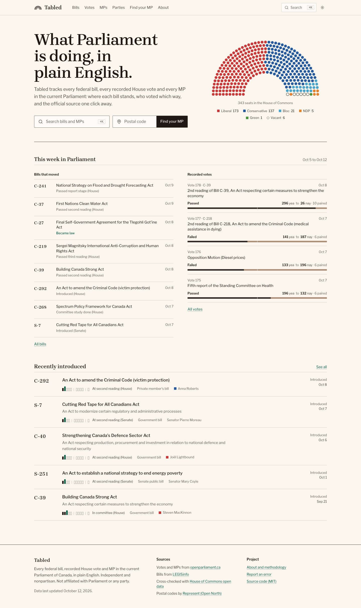
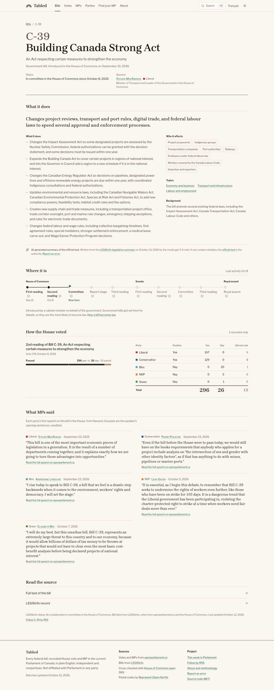
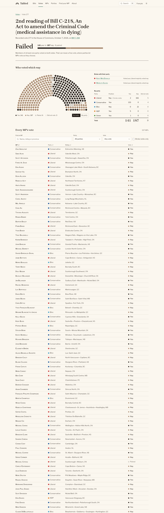
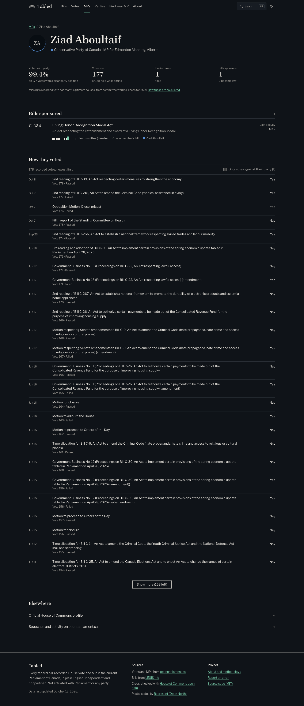
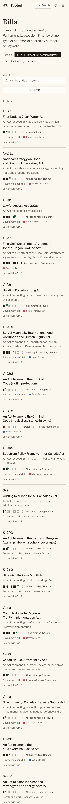

# Tabled

**The Parliament of Canada, in plain English.** Tabled tracks every federal bill, every recorded House of Commons vote
and every MP in the current Parliament, and explains each one so a normal person can understand it in under a minute.
Every number comes from an official or public source, and the source is always one click away.

| Home | Bill | Vote |
| --- | --- | --- |
|  |  |  |

| MP (dark) | Phone |
| --- | --- |
|  |  |

More in [`docs/screenshots/`](docs/screenshots/): every route at 1440px and 390px, light and dark.

## What it does

- **Bills**: search and filter every bill by stage, chamber, type, sponsor's party and whether it became law. Each bill
  page shows where it is in a stage-by-stage timeline across both chambers (with a plain explainer for every stage),
  every recorded vote on it with a party breakdown, and links to the full text and LEGISinfo.
- **Votes**: every recorded division, with a seat chart coloured by ballot, a party-by-party breakdown, the MPs who
  broke with their party, and a sortable, filterable table of every MP's vote.
- **MPs**: a directory with party-line rate, votes cast and bills sponsored, and a page per MP with their full voting
  record (dissents highlighted).
- **Find your MP** by postal code, including codes that span more than one riding.
- **Parties**: seats, cohesion, split votes and bills sponsored.
- **Plain-English summaries** (AI-generated, clearly labelled, grounded in the official text). See "Summaries" below.
- **The previous session** (44-1): bills, votes and MP records, with a session switcher.
- **French**: every page under `/fr`, using Parliament's official French data.
- **This week in Parliament**: a weekly digest, with RSS feeds for the digest, each bill and each MP.
- **Compare two MPs**: how often any two MPs voted the same way.
- Command palette search (Cmd/Ctrl+K), light and dark themes, Open Graph images, sitemap.

## Run it locally

Requires Node 22+ and pnpm 9.

```bash
pnpm install
pnpm ingest          # build data/tabled.db from live sources (about 15 minutes cold; seconds with the cache)
pnpm dev             # http://localhost:3000
```

`pnpm build` runs the ingest automatically if `data/tabled.db` is missing.

### Scripts

| Script | What it does |
| --- | --- |
| `pnpm dev` / `build` / `start` | Next.js development server, production build, production server |
| `pnpm ingest` | Full ingest of the current and previous sessions into `data/tabled.db` (about 15 minutes cold) |
| `pnpm ingest:recent` | Re-fetch lists and anything active in the last 30 days; reuse the cache for the rest |
| `pnpm summarize` | Generate plain-English summaries for new or changed bills (needs `ANTHROPIC_API_KEY` or `OPENAI_API_KEY`) |
| `pnpm typecheck` / `lint` | TypeScript (strict) and ESLint |
| `pnpm test` | Unit tests (Vitest) against real recorded responses in `tests/fixtures/` |
| `pnpm test:e2e` | End-to-end and accessibility tests (Playwright + axe) against a production build |
| `pnpm screenshots` | Capture every route at 1440px and 390px, light and dark, into `docs/screenshots/` |

### Environment

Copy `.env.example` to `.env`. Everything is optional:

- `ANTHROPIC_API_KEY` or `OPENAI_API_KEY`: enables `pnpm summarize`. A valid Anthropic key is used first, then OpenAI;
  `SUMMARY_PROVIDER=anthropic|openai` forces one. Without either the site still works and bill pages show the official
  summary from Parliament instead.
- `SUMMARY_MODEL`: optional override. Defaults are `claude-haiku-4-5` (Anthropic) and `gpt-5.4-mini` (OpenAI). Each
  summary records and shows the model that wrote it.
- `NEXT_PUBLIC_SITE_URL`: canonical URL used in metadata, Open Graph and the sitemap.

## Data sources and credit

| Source | Used for |
| --- | --- |
| [openparliament.ca](https://openparliament.ca) API | MPs, recorded votes, every MP's ballot |
| [LEGISinfo](https://www.parl.ca/legisinfo/en) | Bill status, stages, dates, sponsors, bill text links and summaries |
| [House of Commons open data](https://www.ourcommons.ca/en/open-data) | Cross-check of every vote; the official record wins when sources disagree |
| [Represent by Open North](https://represent.opennorth.ca) | Postal code to riding |

Tabled would not exist without openparliament.ca. Exact endpoints, fields and quirks are documented in
[`docs/DATA_SOURCES.md`](docs/DATA_SOURCES.md). All requests identify Tabled with a descriptive User-Agent, use a disk
cache, and limit concurrency to 3 with exponential backoff.

## How it works

```
scripts/ingest/        fetch (cached, polite) -> normalize -> derive metrics -> write data/tabled.db
  http.ts              disk cache, concurrency limit, backoff
  normalize/           pure parsers for each source, unit tested on recorded responses
  metrics.ts           party positions, party-line rate, dissent, votes cast
scripts/summarize/     grounded AI summaries with validation and a per-bill cache in data/summaries/
src/db/                Drizzle schema and migrations (SQLite via better-sqlite3)
src/lib/queries.ts     read-only queries used by pages at build time
src/app/               Next.js App Router pages (Cache Components); every bill, vote and MP page is prerendered
src/app/api/find/      the only runtime route: postal code lookup, cached per code for a day
```

- **Rendering**: pages read SQLite synchronously at build time and are prerendered. List filters run in the browser
  with state in the URL, so filtered views are shareable and the prerendered HTML contains real content.
- **Metrics**: a party's position on a vote is the side most of its voting MPs took (at least two needed). Party-line
  rate is the share of an MP's yea/nay votes matching that position; paired and absent ballots are excluded. Full
  methodology is on the About page (`/about`).
- **Reconciliation**: openparliament.ca totals are checked against the House of Commons feed on every ingest. Where they
  differ, the official record is used for that vote (for example, openparliament.ca's vote 45-1/148 duplicates vote 140).

### Summaries

`pnpm summarize` grounds each summary in, in order: the bill summary published on LEGISinfo, the bill's full text
(found through the parl.ca document viewer's XML), or the LEGISinfo record. Bills with only a title are never
summarized. Long bills are summarized part by part, then synthesized. Every output is validated with Zod and a
content checker (length limits, a ban list of loaded words, no em dashes) and retried up to twice. Results are cached
in `data/summaries/<session>/<bill>.json` keyed by a hash of the source text and committed, so they are only
regenerated when the official text changes.

## Deploy on Vercel

1. Import the GitHub repo into Vercel (framework preset: Next.js). The default build command `pnpm build` ingests live
   data during the build, so no database setup is needed.
2. Set `NEXT_PUBLIC_SITE_URL` to your production URL.
3. Create a Deploy Hook in Vercel (Settings, Git, Deploy Hooks) and save it as the GitHub secret `VERCEL_DEPLOY_HOOK`.
4. Add `ANTHROPIC_API_KEY` or `OPENAI_API_KEY` as a GitHub secret if you want the daily job to generate summaries.

`.github/workflows/refresh.yml` runs daily: it refreshes recent data, generates summaries for new or changed bills,
commits the summary cache and triggers the deploy hook. `.github/workflows/ci.yml` runs typecheck, lint, unit tests,
build and the end-to-end suite on every push and pull request.

## Contributing

See [CONTRIBUTING.md](CONTRIBUTING.md). Found a mistake? [Open an issue](https://github.com/yasher3413/tabled/issues/new).

## Licence

[MIT](LICENSE). Data belongs to its publishers; see each source's terms.
